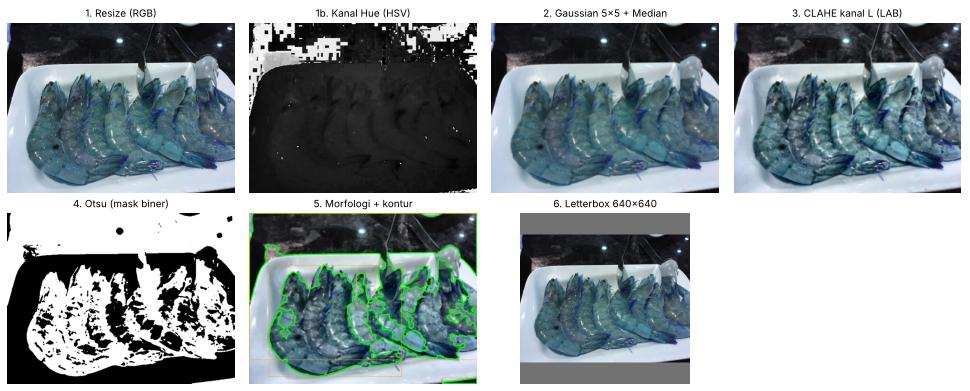
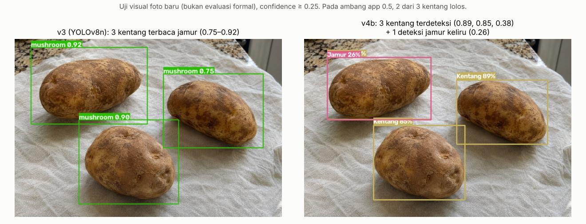
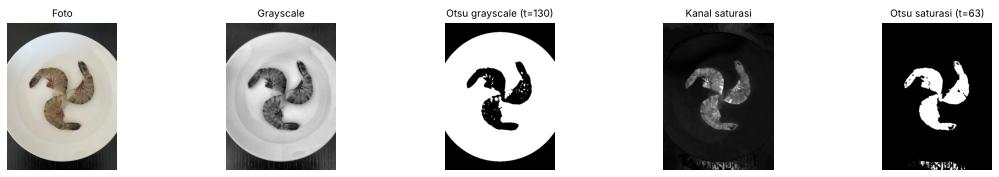

# ReSnap: Recipe from a Snap

Take a photo of raw cooking ingredients, detect them with YOLOv8, and get Indonesian recipes you can cook with what you have. Everything runs locally: no external API and no LLM.

Final project for the Image Processing and Computer Vision course, Universitas Brawijaya (2026).



## How it works

```
photo -> OpenCV preprocessing -> YOLOv8s detection (30 classes) -> editable ingredient list -> recipe matching (14,658 recipes) -> top-5 recipes + missing ingredients
```

1. **Preprocessing** (`src/preprocessing.py`): aspect-preserving resize, Gaussian + median smoothing, CLAHE on the L channel (LAB), Otsu thresholding on the HSV saturation channel, morphological opening/closing, contour extraction, letterbox to 640x640, normalization to [0, 1].
2. **Detection** (`src/detector.py`): YOLOv8s fine-tuned from COCO weights, NMS IoU 0.7, confidence threshold 0.5. Boxes are mapped back to the original photo.
3. **Recipe matching** (`src/recipe_local.py`): each recipe's ingredient list is mapped to the 30 detection classes with ordered rules (e.g. "laos" -> galangal, "telur ayam" -> egg). Pantry staples (salt, sugar, oil, soy sauce, etc.) are assumed available. Recipes are ranked by `|detected ∩ recipe| / |recipe|`, with ties broken by fewest missing ingredients, then most matched, then popularity.

Detected classes: tomato, egg, onion, shallot, garlic, chili, carrot, potato, cabbage, broccoli, cauliflower, cucumber, eggplant, mushroom, spinach, green onion, green beans, long beans, corn, pumpkin, lime, ginger, turmeric, galangal, lemongrass, tofu, tempeh, chicken, fish, shrimp.

## Results

All versions are compared on the same validation set (1,069 images). The test set (654 images) was evaluated once, after the final model was chosen.

| Model | Precision | Recall | mAP@0.5 | mAP@0.5:0.95 | Train-val gap* |
|---|---|---|---|---|---|
| v3 (YOLOv8n) | 0.704 | 0.605 | 0.648 | 0.426 | 0.218 |
| v4 (YOLOv8s + Open Images) | 0.713 | 0.651 | 0.687 | 0.480 | 0.355 (rejected, overfit) |
| **v4b** (v4 + stronger regularization) | 0.717 | 0.657 | 0.694 | 0.481 | 0.274 |

\*mAP@0.5:0.95 on 600 non-augmented training images minus validation mAP@0.5:0.95.

- **Test set, v4b:** precision 0.684, recall 0.650, mAP@0.5 0.694, mAP@0.5:0.95 0.465 (v3: 0.679 / 0.437).
- **Weak classes fixed with targeted data:** v3 misread potatoes as mushrooms and peeled shrimp as garlic. Adding 680 filtered Open Images V7 photos raised holdout AP50 for potato from 0.01 to 0.53, shrimp from 0.14 to 0.45, and mushroom from 0.24 to 0.71.



### What I learned along the way

- **Diagnose before retraining.** v3 had already converged, so more epochs would not help. The real causes were too little data for a few classes and the capacity of YOLOv8n.
- **Clean the added data.** Open Images photos were filtered before training:
  - "group-of" boxes, where one box covers a whole pile, were removed
  - illustrations were removed
  - near-duplicates of the existing train/val/test images were removed using dHash, mirror images included
  - photos containing other ReSnap classes that had no label were caught using the v3 model with an intersection-over-area check
- **Measure overfitting explicitly.** v4 scored well on validation, but its train-val gap was 0.355, so it was rejected. v4b removed duplicate oversampling, used full mosaic plus mixup, and raised weight decay. That brought the gap down to 0.274 with no loss of validation mAP.
- **Classical preprocessing is not always good for a CNN.** An ablation showed that feeding smoothed + CLAHE images to YOLO lowered mAP@0.5 by 3.9 points on validation and 5.1 points on test, because the model was trained on raw photos (domain shift). The preprocessing pipeline is kept for analysis and visualization, and is off by default for detection.



## Run it

```bash
pip install -r requirements.txt
streamlit run app.py
```

From the command line:

```bash
python resnap_pipeline.py contoh/foto_udang.jpg --out output.json --gambar output.jpg
```

From Python:

```python
from resnap_pipeline import scan, rekomendasi

result = scan("photo.jpg")                       # detections + ingredients + top-5 recipes
recipes = rekomendasi(["egg", "tomato", "shallot", "chili"])
```

Example: `{egg, tomato, shallot, chili}` returns "Telor ceplok balado" with a 100% match. See `contoh/` for full JSON outputs and `INTEGRASI.md` for the output schema and a FastAPI example.

If `data/recipes.json.gz` is missing, download the [Indonesian Food Recipes dataset](https://www.kaggle.com/datasets/albertnathaniel12/food-recipes-dataset) and rebuild it with:

```bash
python scripts/build_recipe_db.py --csv Indonesian_Food_Recipes.csv
```

Run the tests with `python -m pytest tests/ -q`.

## Repository layout

| Path | Contents |
|---|---|
| `src/` | preprocessing, detector, local recipe matcher, online fallback (Spoonacular/TheMealDB) |
| `app.py` | Streamlit app |
| `resnap_pipeline.py` | one-call `scan()` / `rekomendasi()` API and CLI |
| `scripts/` | auto-annotation, training, evaluation and ablation, ONNX export, Open Images filtering, fit diagnosis, recipe DB builder |
| `notebooks/` | retraining (Colab/Kaggle), final test evaluation, pipeline demo, step-by-step walkthrough of the preprocessing methods |
| `models/` | `best.pt` / `best.onnx` (v4b), `best_v3.*` (previous model) |
| `hasil/` | ablation results |

## Limitations

- Weakest test classes: turmeric (AP50 0.19), shrimp (0.28, only 6 objects in test), galangal (0.35), broccoli (0.37).
- Dense piles are only partly detected, so the box count is not the real item count.
- Otsu on saturation does not work well for pale ingredients such as egg, garlic and tofu, and classical segmentation cannot separate touching objects of the same kind.
- The recipe database covers 8 main-ingredient categories, and it contains no recipe images.

## Team

- **Affan Abyarahman**: dataset, YOLOv8 training and evaluation, local recipe matching
- **Sulthan**: preprocessing pipeline, Streamlit UI, integration
- **Ezekiel**: report and presentation

## Credits

- [Ultralytics YOLOv8](https://github.com/ultralytics/ultralytics), OpenCV, Streamlit
- [Open Images V7](https://storage.googleapis.com/openimages/web/index.html) (CC BY 4.0), downloaded with FiftyOne
- [Indonesian Food Recipes Dataset](https://www.kaggle.com/datasets/albertnathaniel12/food-recipes-dataset) (Cookpad recipes, via Kaggle)
- Example photos from Wikimedia Commons, see `contoh/KREDIT_FOTO.md`

The course version of this README, in Indonesian, is in `README_ID.md`.
